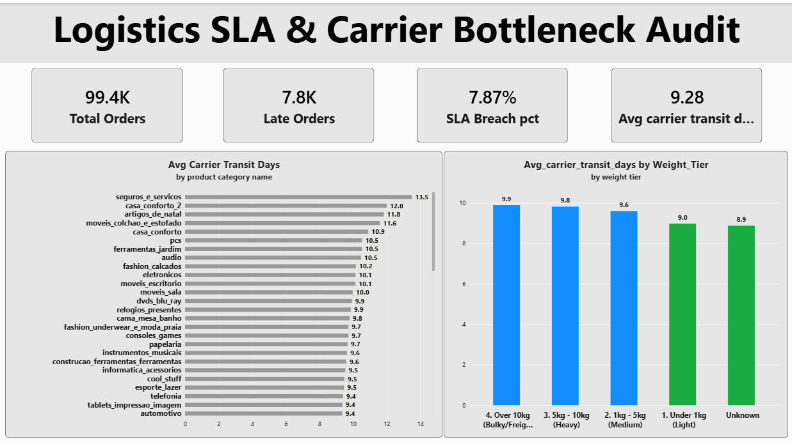

Markdown

# Olist Logistics SLA Audit & Carrier Performance Dashboard

## Methodology
- **Data Architecture:** Ingested Brazilian e-commerce transaction data across orders, line items, and product dimensional schemas into Power BI using a relational star schema.
- **SLA Classification:** Defined delivery breaches at the order grain where the actual customer delivery timestamp strictly exceeded the contractual estimated delivery date ('Order_delivered_customer_date > order_estimated_delivery_date).
- **Transit Isolation:** We have isolated the carrier handling duration ('Datediff' between carrier handover and final doorstep delivery) from the seller dispatch lead timer to pinpoint the exact operational bottleneck.

## Final Recommendations for Contract Renegotiation
- *We have seen more delay on heavy items, so we should apply strict 10-day transit on items that weigh more than 5,000 grams, and if not fulfilled, financial penalties will be applied.
- *Relieve standard parcel carriers of heavy furniture and bulky goods (`moveis_escritorio`, `moveis_decoracao`) and route items above 5 kg through dedicated freight carriers equipped for bulky cargo.
- *We should recalibrate estimated delivery time on the basis of product weights so that we can provide a realistic timeline to customers and avoid negative reviews.
- 
